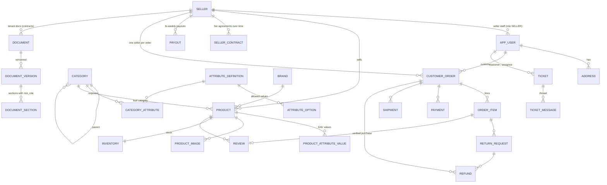

# AgenticShop base platform: data model and read API

This is Phase 0 of the ShopOps plan (`ShopOps_Agentic_Practice_Plan.pdf`): a marketplace backend with many sellers
and seeded fake data. It only reads data and has no authentication yet. Roles, tenants (sellers) and owner columns
are already in the schema, so permission checks can be added later without changing it.

- Backend: `backend/` (Spring Boot 4.1, Java 25, Maven). Package root `com.rmrx.agenticshop`.
- Frontend: `frontend/` (Angular, to be added).
- Database: PostgreSQL 17 (pgvector image) via `docker-compose.yml`. Flyway manages the schema and the seed.
  JPA/Hibernate validates the schema (`ddl-auto: validate`).

## Running

```
docker compose up -d                # Postgres on 5432 (db/user/password: agenticshop)
cd backend
mvn spring-boot:run                 # or: java -jar target/agenticshop-0.0.1-SNAPSHOT.jar
```

| Env var | Default | Purpose |
|---|---|---|
| `DB_URL` | `jdbc:postgresql://localhost:5432/agenticshop` | JDBC URL |
| `DB_USER` / `DB_PASSWORD` | `agenticshop` | credentials |
| `SEED_PRODUCTS` / `SEED_ORDERS` / `SEED_CUSTOMERS` / `SEED_SELLERS` / `SEED_TICKETS` | 50000 / 100000 / 20000 / 500 / 15000 | seed size (only read on the first run) |

- Profile `noseed` applies the schema only.
- Swagger UI: `/swagger-ui.html`. OpenAPI JSON: `/v3/api-docs`.
- The full seed takes about 2 minutes on first start. To re-seed, drop the database (or the `public` schema) and start the app again.

## Code layout

Packages are organized by feature. Each one has `entity`, `repository`, `service` (read-only transactions, MapStruct
mappers), `dto` (Java records) and `web` (controllers).

```
common/    BaseEntity, PageResponse, Ref, Specs (null-safe Specification helpers), ProblemDetail errors, /api/meta
identity/  AppUser, Role, Address
seller/    Seller, SellerContract, Payout
catalog/   Category, Brand, AttributeDefinition, AttributeOption, CategoryAttribute, Product, ProductImage,
           ProductAttributeValue, Inventory, Review   (+ CatalogMetadata in-memory cache, facet repository)
order/     CustomerOrder, OrderItem, Payment, Shipment, ShippingAddress (embedded snapshot)
returns/   ReturnRequest, Refund
support/   Ticket, TicketMessage
risk/      AccountFlag
docs/      Document, DocumentVersion, DocumentSection
```

## Entities and relations



### Identity and roles
- **AppUser**: customers and staff share one table. `role` is one of `CUSTOMER, SELLER, SUPPORT_T1, SUPPORT_T2,
  FINANCE, FRAUD, ADMIN`. A SELLER user always has a `seller_id`; other roles never do (DB check constraint).
  Later, this becomes the session identity (user id, role, seller id).
- **Address**: belongs to a user. One default address, sometimes a second one.

### Sellers (tenants)
- **Seller**: owns products, orders, contracts and payouts. Status is `ACTIVE`, `SUSPENDED` or `OFFBOARDED`
  (products of non-active sellers are `DELISTED`).
- **SellerContract**: the fee agreement between the marketplace and a seller, which sets what the platform keeps
  per sale. It records the plan (`STANDARD` / `PRO` / `ENTERPRISE`), commission rate, per-order fee, monthly fee,
  return window and effective dates. A seller usually has several contracts: a plan upgrade starts a new one, and
  so does the renewal on 2025-01-01 when the seller fee schedule changed. Each contract links to its contract
  document.
- **Payout**: the money sent to a seller every two weeks. `net = gross (items + shipping) - commission - fees - refunds`.
  The seed computes payouts from that seller's real orders and refunds and the contract in force at the time, so the
  numbers add up. Status is `PAID`, `PENDING` (current period) or `ON_HOLD` (seller has an active risk flag).

### Catalog
- **Category**: a 3-level tree (12 roots, 33 groups, 87 leaves). `path` is a materialized path of ids such as
  `/1/12/104/`, so `path like '/1/%'` selects a whole subtree. Products always sit in a leaf.
- **AttributeDefinition / AttributeOption / CategoryAttribute (EAV)**: an attribute has a `data_type` of `ENUM`,
  `MULTI_ENUM`, `NUMBER` or `BOOLEAN` and a unit. Attaching it to a category makes it apply to that whole subtree.
  For example, `warranty_months` is on Electronics and `ram_gb` is on Laptops.
- **Product**: belongs to one seller, one leaf category and one brand. Also holds title, description, price,
  `list_price` (the "compare at" price when on sale), status, and the denormalized `rating_avg`, `rating_count`
  and `sales_count`.
- **ProductAttributeValue**: one row per value. Depending on the type it sets `option_id`, `number_value` or
  `bool_value`.
- **Inventory**: stock for a product (one-to-one, shared primary key), with warehouse and restock date.
- **Review**: written by a customer, usually linked to the order line it came from (verified purchase).

### Orders (one order = one seller, like Etsy splitting a cart)
- **CustomerOrder**: an order number like `AS-250314-004521`, an embedded snapshot of the shipping address, money
  fields (`subtotal`, `shipping_fee`, `tax`, `total`) and a status: `PENDING, PAID, SHIPPED, DELIVERED, CANCELLED,
  RETURNED, REFUNDED, PARTIALLY_REFUNDED`.
- **OrderItem**: copies the product title, SKU and unit price at the time of the order.
- **Payment**: `CARD / PAYPAL / GIFT_CARD / STORE_CREDIT`. Failed attempts are kept as their own rows.
- **Shipment**: carrier (`UPS, FEDEX, DHL, USPS`), tracking number, and `IN_TRANSIT / DELIVERED / LOST`.

### Returns and refunds
- **ReturnRequest**: one order line, with reason, status (`REQUESTED, APPROVED, REJECTED, RECEIVED, DISPUTED,
  CLOSED`) and notes from the customer and the seller.
- **Refund**: may link to a return. Records who issued it (Tier-1 up to $100, Tier-2 above) and has an
  `idempotency_key` reserved for the resilience phase.

### Support
- **Ticket**: customer, optional order and seller, assignee, category, status, priority and tier (`T1` / `T2`).
- **TicketMessage**: author type `CUSTOMER / STAFF / SELLER / SYSTEM`. `internal` marks staff-only notes.

### Risk
- **AccountFlag**: on a customer or a seller (`subject_type` + `subject_id`). Types are `REFUND_ABUSE, CHARGEBACK,
  ACCOUNT_TAKEOVER, FAKE_REVIEWS, POLICY_VIOLATION`, each with a risk score. This is fraud-team data.

### Documents (RAG corpora with ACL metadata)
- **Document**: `code`, type (`PUBLIC_POLICY, SUPPORT_SOP, SELLER_CONTRACT, FRAUD_PLAYBOOK`), `min_role`, and
  `seller_id` for documents that belong to one seller.
- **DocumentVersion**: `effective_from` (inclusive) to `effective_to` (exclusive). Null means it is the current
  version.
- **DocumentSection**: markdown body plus its own `min_role`, for section-level ACLs (some SOP sections are
  Tier-2 only).

## Seed data

All of it is deterministic (`setseed`) and generated by Flyway SQL in `db/seed` (V100–V110). A staging schema
`seed` holds hand-written reference data and is dropped at the end. "Now" is fixed at 2026-11-20, and the
history starts on 2023-12-01.

| What | How it stays meaningful |
|---|---|
| Categories, attributes | A real retail taxonomy. Each category has only the attributes and values that make sense for it (laptop RAM 8–64 GB, T-shirt sizes XS–XXL, cookware materials…). |
| Brands | Fictional brands, each limited to fitting groups (laptop brands only make computers). |
| Products (50k) | The title is built from the product's own attribute values, e.g. `Novatek Aero 14" Laptop, Core i7, 16GB RAM, 512GB SSD, Windows 11`. Price grows with specs (per-value multipliers), and about 22% are on sale. The description has an intro from a per-category template, a spec list and category care/warranty text. |
| Sellers (~500) | Named after what they sell (e.g. "Maple Street Apparel Outlet"). Their products come from their main (and sometimes a second) root category, and seller size is heavy-tailed. |
| Customers (20k) | US/UK/CA/DE names, cities, postal codes and phone formats. Some buy much more often than others. |
| Orders (100k) | Seasonal (Black Friday, December, summer sale) and growing over time. Lines come only from the order's seller. Totals add up (subtotal + shipping rule + tax by country/state). Status matches the timeline: old orders are delivered, recent ones are in transit or pending, about 0.4% of parcels are lost and about 5% arrive late. |
| Returns / refunds | Return rate depends on category and product quality. Reasons depend on category (apparel: fit; electronics: defects). Windows and fees follow the return-policy version in force on the order date. Refunds come from returns, lost parcels (full refund) and late deliveries (goodwill credit). |
| Reviews | Only from delivered order lines. The rating follows the product's hidden quality and any return, and the text comes from per-category phrase banks matching the rating ("Battery drains in a few hours" is a 1–2★ electronics review). |
| Tickets (~15k) | Built from real situations: late or lost parcels, damaged items, refund status, disputes (with seller replies and internal notes), failed payments, cancellations, account and pre-sale questions. Messages quote the real order number, product, carrier, tracking number and amount. A few escalated threads have about 200 messages. |
| Documents | Return policy v1/v2/v3 (30d → 14d + fees → 30d/15d electronics), shipping policy v1/v2, warranty, seller fee schedule v1/v2, support SOP v1/v2 (Tier-2-only sections) and fraud playbook. Every seller also gets a contract document with one version per contract. |
| Flags | Refund abuse (3+ returns), chargebacks after lost-parcel refunds, account takeover, sellers with high return rates, suspected fake reviews. |

## REST API (read-only, `GET`, prefix `/api`)

Paged responses use this shape: `{ content, page, size, totalElements, totalPages }`. `page` starts at 0 and `size`
is capped at 100. Errors are RFC 9457 `ProblemDetail` (404 for unknown ids, 400 for bad parameters).

### Catalog
| Endpoint | Notes |
|---|---|
| `/categories` | Full tree (nested). |
| `/categories/{idOrSlug}` | Detail with breadcrumbs and children. |
| `/categories/{idOrSlug}/filters` | Filterable attributes, including inherited ones, with options or ranges. These drive the filter UI. |
| `/brands?q=&categoryId=` | Brands, optionally only those with products in a category subtree. |
| `/products` | Search and filter. See below. |
| `/products/facets` | Same filters as `/products`. Returns counts for the sidebar. |
| `/products/{id}` | Detail: attributes, images, brand, seller, breadcrumbs, stock. |
| `/products/{id}/reviews?rating=&sort=newest\|helpful` | Paged reviews. |
| `/products/{id}/reviews/summary` | Average and 1–5★ distribution. |

**Product filters:** `q` (every word must appear in the title), `categoryId` (includes the subtree), `sellerId`,
`brandIds=1,2`, `minPrice`, `maxPrice`, `minRating`, `inStock=true`, and attribute filters:
- `attr.<code>=v1,v2`: ENUM option values (OR within an attribute), NUMBER exact values, or BOOLEAN `true/false`
- `attr.<code>.min` / `attr.<code>.max`: NUMBER ranges
- different attributes are combined with AND

Sorting: `sort=relevance|bestselling|price_asc|price_desc|newest|rating`.

Example: `/api/products?categoryId=14&attr.ram_gb=16,32&attr.screen_size_in.min=15&brandIds=3&sort=price_asc`

**Facets** (`/products/facets`) return `total`, `categories` (counts per child of the selected category), `brands`,
`price` (min/max), `ratings` (4★+ … 1★+) and `attributes` (per filterable attribute: value counts and a numeric
range). They are disjunctive: each group's counts ignore that group's own selection, so the other options stay
visible.

### Sellers
| Endpoint | Notes |
|---|---|
| `/sellers?q=&status=&country=` | Paged. |
| `/sellers/{idOrSlug}` | Profile, current fee plan, product and order counts. |
| `/sellers/{id}/contracts` | Fee agreements over time (finance data). |
| `/sellers/{id}/payouts` | Bi-weekly payouts, newest first. |

### Customers and users
| Endpoint | Notes |
|---|---|
| `/customers?q=&status=` | Paged; `q` matches name or email. |
| `/customers/{id}` | Profile, addresses, counts (orders, returns, tickets, active flags). |
| `/customers/{id}/orders`, `/customers/{id}/tickets`, `/customers/{id}/reviews` | Paged. |
| `/users?role=&sellerId=&q=` | Staff and seller accounts with their roles. |

### Orders, returns, refunds
| Endpoint | Notes |
|---|---|
| `/orders?q=&status=&customerId=&sellerId=&from=&to=` | `q` matches the order number. `from`/`to` are ISO instants. |
| `/orders/{idOrNumber}` | Lines, payments, shipments, returns and refunds. |
| `/returns?status=&reason=&sellerId=&customerId=&from=&to=` and `/returns/{id}` | |
| `/refunds?status=&orderId=&sellerId=&from=&to=` | |

### Support, risk, documents, meta
| Endpoint | Notes |
|---|---|
| `/tickets?q=&status=&priority=&category=&tier=&customerId=&assigneeId=&sellerId=` | Paged, most recently updated first. |
| `/tickets/{id}`, `/tickets/{id}/messages` | Messages are paged, oldest first. |
| `/flags?subjectType=&subjectId=&flagType=&active=` | Fraud-team data. |
| `/documents?type=&sellerId=&q=` | Document list. |
| `/documents/{code}` | Version list. |
| `/documents/{code}/versions/{n}` | Sections, each with its `minRole`. |
| `/documents/{code}/effective?at=2025-03-01` | The version in force on a date (time-aware policy lookup). |
| `/meta/enums` | Every enum's values, for UI dropdowns. |

## Deliberately not done yet
- Authentication, request identity and row- or section-level permission checks. The data needed for them (`role`,
  `seller_id`, `min_role`, owner columns) is already there.
- Write endpoints and actions (refund, cancel…), chaos middleware, embeddings or vector search, and tests
  (Testcontainers is planned for the agent phases).
